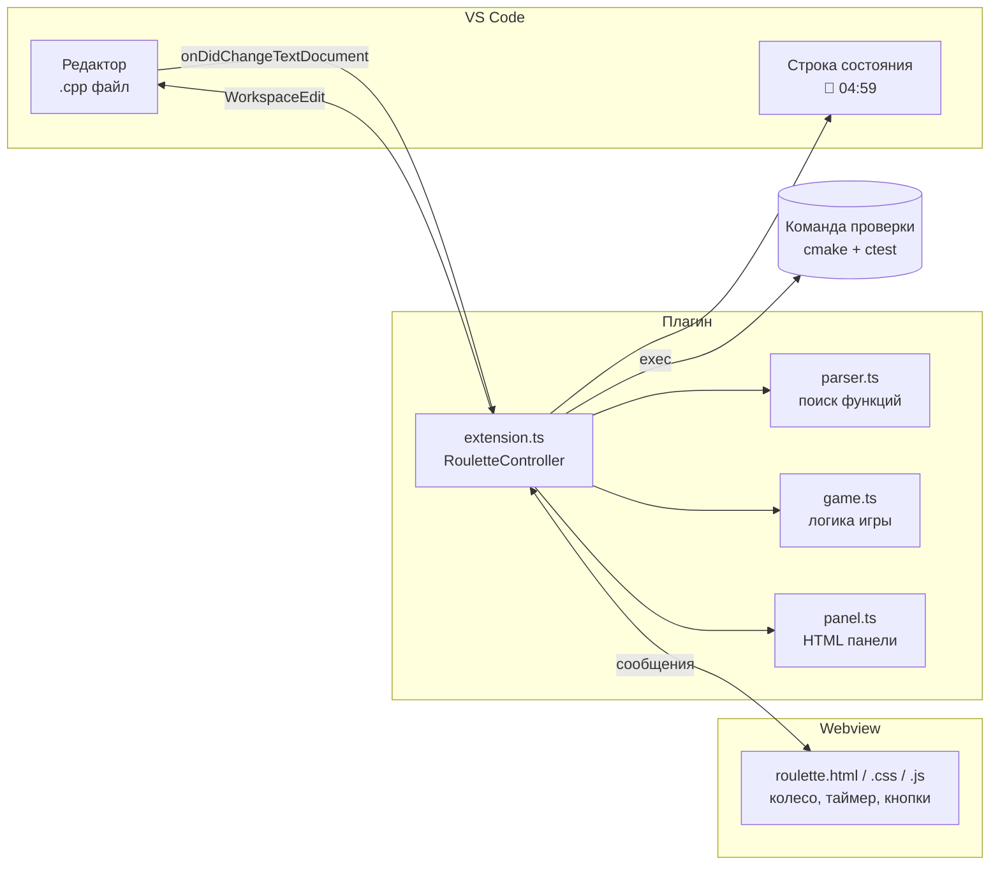
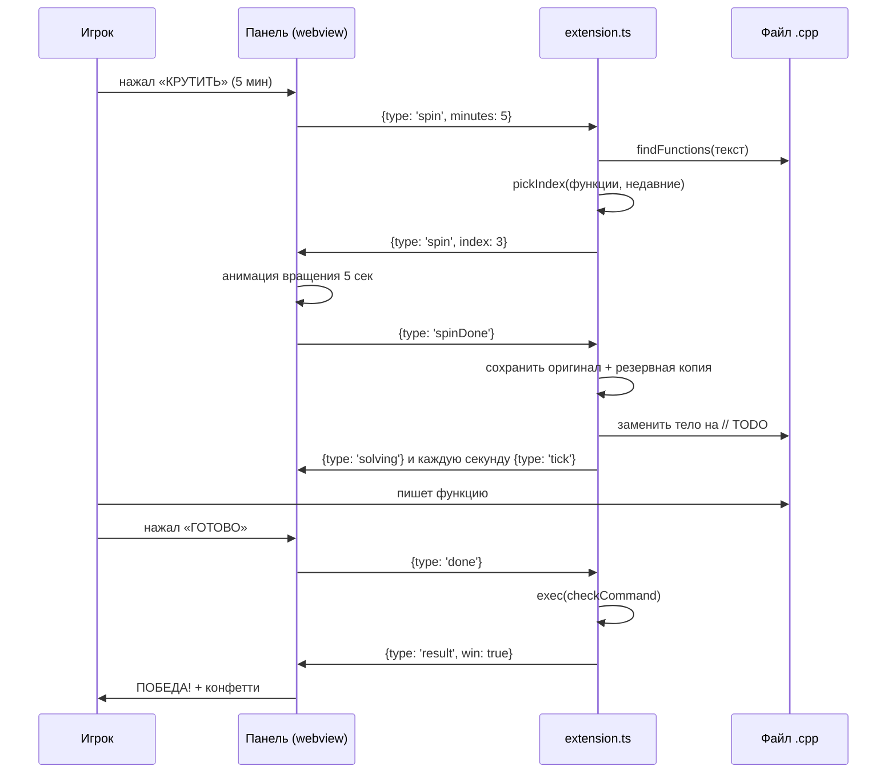
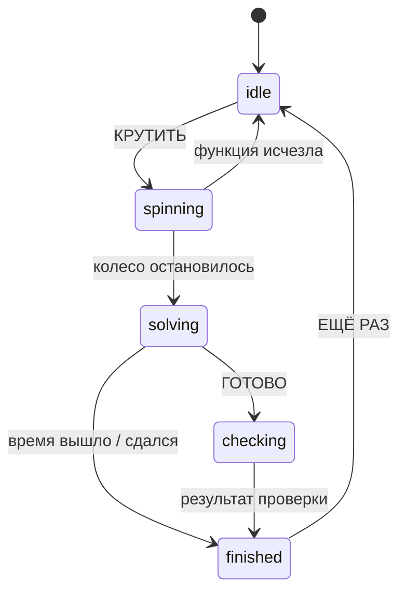

# 📚 Документация Code Roulette

Автор: **Космычев Никита Александрович**, группа **M3118**

---

## 1. Как VS Code подключает плагины

Плагин VS Code — это пакет Node.js с файлом `package.json`. Главное в нём:

| Поле | Зачем нужно |
|---|---|
| `main` | файл, который VS Code загрузит (`out/extension.js`) |
| `activationEvents` | когда запускать плагин: при открытии файла на `cpp` или `c` |
| `contributes.commands` | команды в палитре `Ctrl+Shift+P`: открыть рулетку, сдаться |
| `contributes.configuration` | настройки: `checkCommand`, `skipMain`, `minLines` |

Плагин работает в отдельном процессе **Extension Host** и общается с редактором через API `vscode`.
Возможности API, которые использует Code Roulette:

| API | Для чего |
|---|---|
| `window.createWebviewPanel` | панель с рулеткой — это HTML-страница внутри VS Code |
| `webview.postMessage` / `onDidReceiveMessage` | обмен сообщениями между плагином и панелью |
| `window.createStatusBarItem` | кнопка «🎰 Рулетка» и таймер в строке состояния |
| `WorkspaceEdit` + `workspace.applyEdit` | стирание и возврат тела функции |
| `workspace.onDidChangeTextDocument` | слежение за правками (защита от Ctrl+Z) |
| `ExtensionContext.globalState` | хранение статистики между запусками |
| `ExtensionContext.globalStorageUri` | папка для резервной копии функции |
| `child_process.exec` (Node.js) | запуск команды проверки (сборка + тесты) |

---

## 2. Архитектура



| Модуль | Что делает | Зависит от VS Code? |
|---|---|---|
| `parser.ts` | находит функции и границы их тела | ❌ нет: тестируется отдельно |
| `game.ts` | состояния игры, выбор функции, статистика, распознавание читов | ❌ нет: тестируется отдельно |
| `panel.ts` | собирает HTML панели | ✅ да |
| `extension.ts` | управляет игрой и связывает всё вместе | ✅ да |
| `media/*` | внешний вид и анимации панели | работает в webview |

**Важный принцип:** панель только показывает. Какую функцию выбрать и победил ли игрок,
решает плагин. Колесо получает готовый номер сектора и просто красиво докручивается до него.

---

## 3. Ход игры



---

## 4. Конечный автомат состояний (`game.ts`)



Допустимые переходы хранятся в таблице `Map<GameState, GameState[]>`, а функция
`canTransition(from, to)` проверяет переход. Поэтому, например, повторное нажатие
«ГОТОВО» во время проверки просто игнорируется.

---

## 5. Поиск функций (`parser.ts`)

### Шаг 1. Очистка — `cleanCode(text)`

Конечный автомат проходит по тексту и заменяет пробелами комментарии `//` и `/* */`,
строки `"..."`, символы `'...'` и директивы `#include`. Длина текста не меняется,
поэтому позиции символов совпадают с исходным файлом. Это нужно, чтобы `{` внутри
строки `"{ not a brace }"` или функция в комментарии не сбивали разбор.

### Шаг 2. Стек скобок — `findFunctions(text)`

Идём по очищенному тексту и храним стек открытых `{`:

| Встретили | Действие |
|---|---|
| `{` | если мы не внутри функции и текст перед скобкой похож на заголовок — это начало функции, кладём в стек `true`, иначе `false` |
| `}` | снимаем со стека; если сняли `true` — нашли конец функции |
| `;` | запоминаем границу: заголовок следующей функции начинается после неё |

Заголовок распознаётся регулярным выражением `имя(параметры) const ...`, слова
`if`, `for`, `while`, `switch` функциями не считаются. Метки `public:` / `private:`
и список инициализации конструктора `: x_(x)` отбрасываются.

Результат — список `FunctionRange`:

```ts
interface FunctionRange {
    name: string;        // имя функции
    signature: string;   // заголовок одной строкой: "int sum(int* a, int n)"
    headerStart: number; // где начинается заголовок
    open: number;        // позиция {
    close: number;       // позиция }
    bodyLines: number;   // непустых строк в теле
}
```

---

## 6. Выбор функции (`game.ts`)

`pickIndex(names, recent)` выбирает случайную функцию, кроме тех, что лежат в очереди
`recent` (последние 3 выпавшие). Если все функции недавно выпадали, выбор идёт из всех.
Очередь обновляет `pushRecent`: новое имя добавляется в конец, самое старое удаляется.

---

## 7. Защита от читерства

Во время раунда плагин слушает событие `onDidChangeTextDocument`. Для каждой правки
вызывается `looksLikeOriginal(вставленный_текст, оригинал)`:

1. из обоих текстов убираются все пробелы и переводы строк (форматирование не важно);
2. вставка короче 30 символов — не чит (так печатает человек);
3. если вставка целиком лежит внутри оригинала (Ctrl+Z, вставка части) или оригинал
   целиком лежит внутри вставки (откат файла, вставка целого файла) — это чит.

При чите `punishCheat()` снова стирает тело функции, сдвигает время старта на 30 секунд
и показывает на панели баннер «🚫 ЧИТЕР!» с тряской экрана. Свои правки (стирание,
возврат оригинала) плагин делает с флагом `ownEdit`, чтобы не поймать самого себя.

---

## 8. Проверка решения

По кнопке «ГОТОВО» файл сохраняется, и команда из `codeRoulette.checkCommand` запускается
через `child_process.exec` в папке проекта (тайм-аут 3 минуты). Код выхода `0` означает победу.
Вывод команды пишется в панель **Output → Code Roulette**. Если команда не задана,
победа засчитывается по времени.

---

## 9. Описание функций

### `parser.ts`

| Функция | Параметры | Возвращает |
|---|---|---|
| `cleanCode(text)` | текст файла | текст той же длины без комментариев и строк |
| `parseHeader(header)` | текст перед `{` | `{ name, start }` или `null` |
| `findFunctions(text)` | текст файла | `FunctionRange[]` |
| `indentAt(text, pos)` | текст, позиция | отступ строки |

### `game.ts`

| Функция | Параметры | Возвращает |
|---|---|---|
| `canTransition(from, to)` | два состояния | можно ли перейти |
| `pickIndex(names, recent, random)` | имена, недавние, генератор | индекс выбранной функции |
| `pushRecent(recent, name)` | очередь, имя | новая очередь (не длиннее 3) |
| `formatTime(seconds)` | секунды | строка `ММ:СС` |
| `updateStats(stats, win, seconds)` | статистика, результат, время | новая статистика |
| `looksLikeOriginal(inserted, original)` | вставка, оригинал | похоже ли на чит |
| `placeholderBody(indent)` | отступ | текст `// TODO` вместо тела |

### `extension.ts` — класс `RouletteController`

| Метод | Назначение |
|---|---|
| `open()` | открыть панель рулетки |
| `spin(minutes)` | выбрать функцию и запустить вращение |
| `startRound()` | стереть тело, сохранить оригинал, запустить таймер |
| `onTick()` | обновлять таймер каждую секунду, завершать по времени |
| `finishByDone()` | запустить проверку по кнопке «ГОТОВО» |
| `giveUp()` | сдаться: вернуть оригинал, засчитать поражение |
| `finish(win, text)` | обновить статистику и показать результат |
| `watchForCheats(e)` / `punishCheat()` | защита от Ctrl+Z и вставки оригинала |
| `restoreOriginal()` / `showOriginal()` | вернуть или показать оригинал функции |
| `saveBackup(signature, body)` | сохранить резервную копию |

---

## 10. Тестирование

`src/test/run.ts` содержит 20 тестов: поиск функций (методы классов, конструкторы,
комментарии, скобки в строках), границы и сигнатуры, автомат состояний, выбор без
повторов, очередь недавних, формат времени, статистика и распознавание читов.

```bash
npm test
```

Панель можно открыть и в обычном браузере: без VS Code `roulette.js` включает демо-режим
с выдуманными функциями. Так удобно проверять дизайн.
